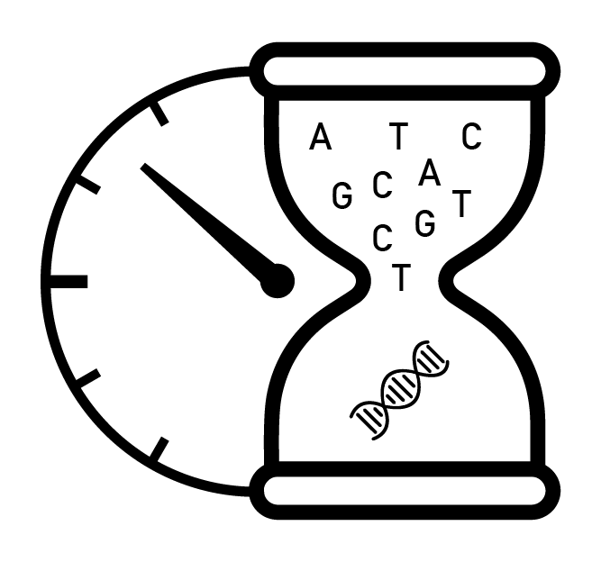
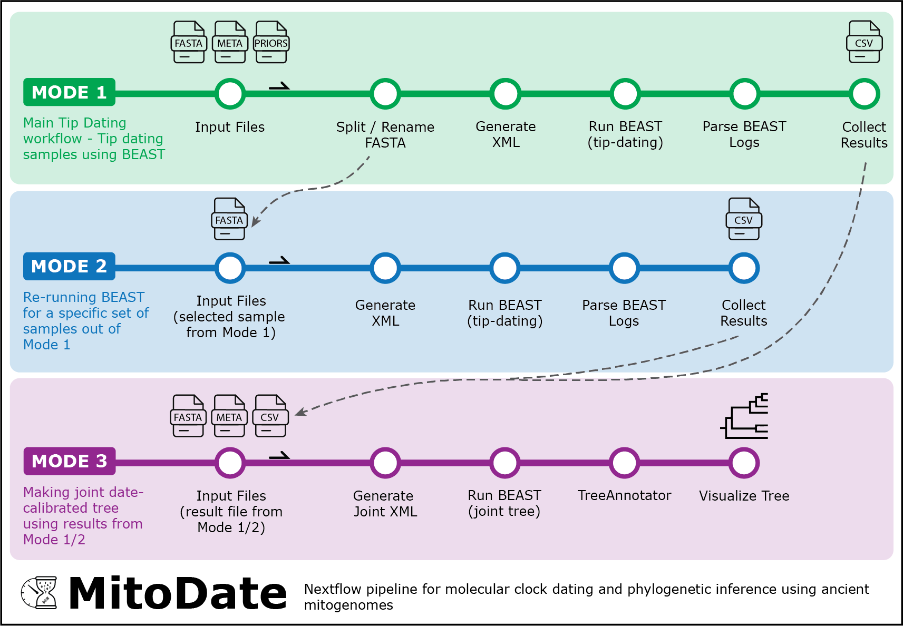

# MitoDate

MitoDate is a Nextflow pipeline for molecular clock dating of ancient mitochondrial genomes with BEAST, following the methodology published in Chacón-Duque et al., MBE (2025).
It can be used in three modes. `tip_dating` runs the main workflow from aligned FASTA, metadata, and priors. `rerun_samples` reruns selected samples from an earlier `tip_dating` run without starting over. `joint_tree` builds the final dated tree after you have reviewed the tip-dating results.

## Quick Navigation

1. [Pipeline Requirements and Configuration](docs/1_requirements_and_configuration.md)
2. [Pipeline Steps](docs/2_pipeline_steps.md)
3. [How to Run MitoDate](docs/3_how_to_run.md)
4. [Data Cleanup](docs/4_data_cleanup.md)
5. [Changelogs](docs/5_changelogs.md)

## Test Data

### Test dataset 1

Example input files for 10 representative samples from Chacón-Duque et al., MBE (2025) are in [`assets/test_data/Chacon-Duque-2025`](assets/test_data/Chacon-Duque-2025).

A tutorial for running this dataset is in [`Run_test_dataset1.md`](assets/test_data/Chacon-Duque-2025/Run_test_dataset1.md).

### Test dataset 2

Example input files from Lei et al. (2026; [doi:10.1126/science.aed0430](https://doi.org/10.1126/science.aed0430)) are in [`assets/test_data/Lei-2026`](assets/test_data/Lei-2026).

## Support

Wenxi Li (vanssy0819@gmail.com)
Bilal Sharif (bilal.bioinfo@gmail.com)

## Citation

If you use MitoDate in your research, please cite:

